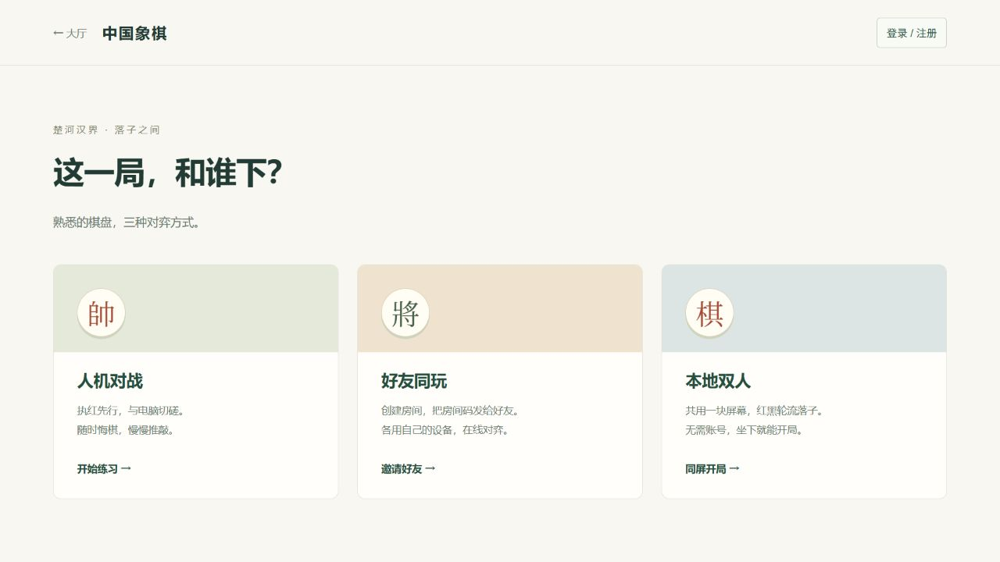

# Xiangqi Friends · 中国象棋

经典木纹棋盘，浅色界面，支持 **人机对战、好友联机、本地双人**。从桌游平台中独立整理，只包含象棋与它需要的账号服务。



## 本地运行

需要 Node.js 24 和 pnpm 10.34.9。项目包含原生 SQLite 依赖，安装时允许其构建脚本运行。

```sh
pnpm install --frozen-lockfile
```

把 `.env.example` 复制为 `.env`，然后：

```sh
pnpm db:migrate
pnpm dev
```

打开 http://localhost:5176 。后端只监听本机 3006 端口。

- 人机：游客执红，电脑执黑，支持悔棋和翻转。
- 本地双人：同一屏幕轮流操作红黑双方，悔棋退一手，不需要账号。
- 好友联机：双方各自注册/登录，房主建房并分享 10 位房间码，好友加入执黑，两人到齐后开局。测试两个账号时请使用不同浏览器或隐私窗口，普通标签页会共用登录 Cookie。

## 联机行为

服务器持有棋局，校验身份、轮次、坐标、规则和版本。客户端只提交走法；同一请求重试不会重复落子。棋局和着法存入 SQLite，刷新后可从“继续我的房间”恢复。客户端约每 1.2 秒同步一次，网络中断不立即判负。等待房间可取消；进行中的对局可认输。最多同时保留 3 个进行中的房间。

本版没有计时、匹配、观战、联机悔棋、重复局面与长将长捉裁决。没有排行榜或正式联机积分；AI 不承诺特定棋力。

## 检查与构建

```sh
pnpm typecheck
pnpm test
pnpm test:classic
pnpm build
```

`pnpm test` 覆盖账号与房间权限、并发加入、走法拒绝、请求幂等、版本冲突、重启恢复和两种新增棋盘模式。`test:classic` 是原棋盘的 113 条断言及预算专项回归。

前端产物位于 `apps/web/dist`，后端产物位于 `apps/server/dist`。

## 只玩离线版

`portable/中国象棋-直接打开.html` 是预先生成的单文件版，不需要安装依赖，默认人机对战。`portable/index.html` 可选择人机或本地双人。好友联机必须运行完整项目和服务器，不能只上传静态 HTML。

修改棋盘源码后，可运行 `python apps/web/public/xiangqi/tools/build_single.py` 重建单文件，再复制到 portable 目录。Python 只用于这个可选打包步骤。

## 上线

见 [docs/deployment.md](docs/deployment.md)。生产环境须配置自己的 HTTPS 域名、WEB_ORIGIN 和持久数据库位置。仓库不包含真实域名配置、账号、数据库、Cookie、SSH 密码或生产日志；`.env.example` 仅是本地示例。

这是独立发行版，数据库从迁移 1 开始，**不要把原平台数据库直接放进来**。开发版账号表不支持找回密码、邮箱验证或管理后台。

## 源码结构

- `apps/web`：Vue 页面、账号界面、原棋盘与浏览器模式测试。
- `apps/server`：Fastify 账号和好友房间 API、SQLite 持久化与测试。
- `packages/game-core`：服务器复用的纯规则和中文记谱。
- `packages/contracts`：房间与走法类型。
- `portable`：离线单文件入口。

规则源码在浏览器和服务器各有一份，相同内容由测试检查。修改规则时请同时更新两份，再运行测试。

## 许可

代码采用 [MIT](LICENSE)。木纹棋子素材采用 CC BY 4.0，须保留作者与许可说明，详见 [NOTICE.md](NOTICE.md)。
